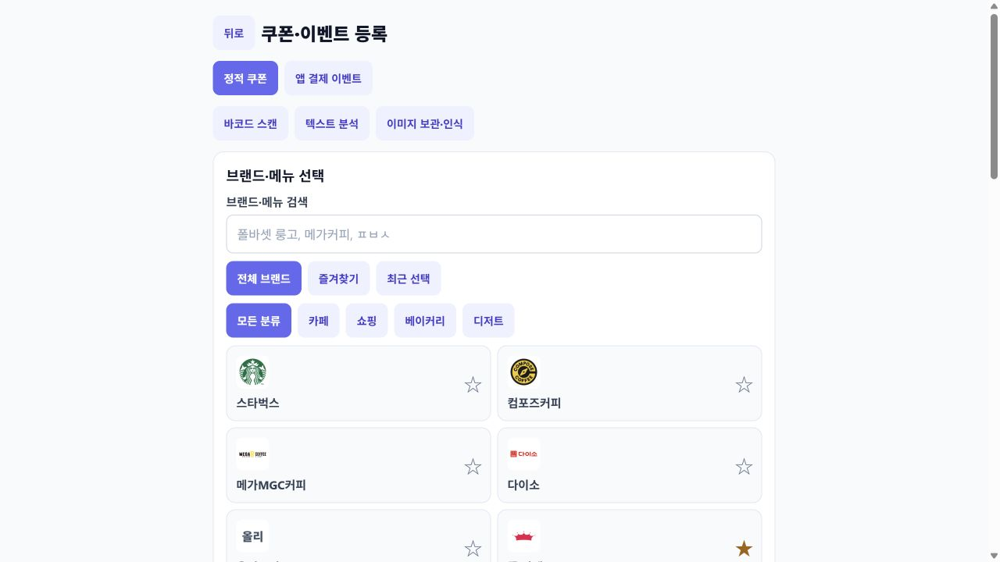
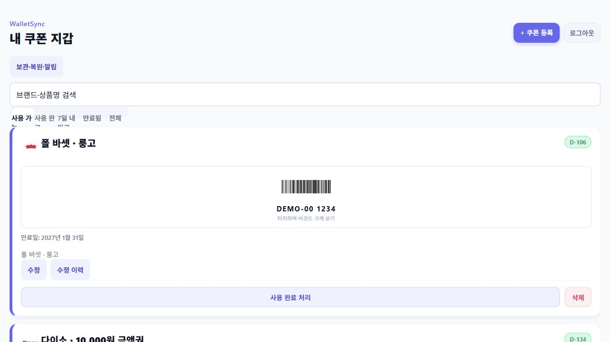
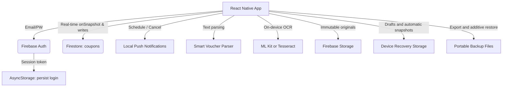

# WalletSync

> A cross-platform coupon wallet that tracks voucher expiry dates and renders scannable barcodes.

[](https://opensource.org/licenses/MIT)


## Motivation

Gift vouchers arrive as images in chat rooms and end up buried in the camera roll. The gallery does not know that a picture is worth money, so it cannot sort by expiry date, cannot tell which ones are already spent, and cannot warn that one runs out this week. The value quietly expires.

WalletSync treats a coupon as a record instead of a photo: it has a brand, a barcode, an expiry date, and a used-or-not state, and those are the four things the app is built around.

## What It Does

- Register, sign in and request password recovery; sessions persist across relaunches.
- Choose from an offline catalogue of 17 merchant entries and 57 selected products, or use scans, local OCR, pasted text and custom entry. Generated titles remain editable; original barcode payloads and symbology are preserved.
- Search brands and products by aliases or Korean initial consonants, save device favourites and recent choices, and filter active · used · expired · expiring-soon coupons. Expiry reminders are configurable per device; calendar dates stay stable across daylight-saving boundaries.
- Track payment-app events with conditions and original-provider links. Dynamic payment credentials remain in the provider's app.
- Synchronise records through Firestore, recover deletions from trash and edits from version history, and export JSON · CSV · PDF. Validated JSON and CSV restores add missing coupons without overwriting existing records.

The interface is in Korean. Each account only ever loads its own coupons.

Browser captures below use local emulators and synthetic vouchers. The brand
picker capture renders the real registration component in a layout harness.




## Architecture



Coupon state is synced via Firestore `onSnapshot` real-time listeners, with pull-to-refresh (`RefreshControl`) as a manual fallback. Transactions reserve voucher identities, check revisions and archive the previous document before each change. Removal moves a record to trash. Native recovery copies use alternating files; web recovery uses IndexedDB.

```text
wallet-sync/
├── App.js                        # Root component, auth-based navigation
├── firestore.rules               # Firestore security rules
├── src/
│   ├── components/
│   │   └── BarcodeRenderer.js    # Symbology-aware SVG renderer
│   ├── screens/
│   │   ├── auth/                 # Login, registration, password recovery
│   │   └── home/                 # Wallet, editor, history and recovery tools
│   ├── services/
│   │   ├── authService.js        # Login, signup, logout helpers
│   │   ├── firebase.js           # Firebase app and service initialisation
│   │   ├── firestoreService.js   # Transactions, history, trash and real-time sync
│   │   ├── backupService.js      # Portable exports and resumable restore
│   │   ├── imageService.js       # Durable originals and authenticated uploads
│   │   ├── localRecovery.js      # Account-scoped drafts and snapshots
│   │   ├── ocrService.*.js       # Native and browser OCR adapters
│   │   └── notificationService.js# Expiry notification scheduling
│   └── utils/
│       ├── authUtils.js          # Localised error code mappings
│       ├── barcodeEncoder.js     # Code 128 encoding patterns
│       ├── dateUtils.js          # Expiry D-day calculations & sorting
│       └── voucherParser.js      # Smart gifticon text/brand/date extraction
└── tests/
    ├── auth.test.js              # Auth error mapping tests
    ├── barcode.test.js           # Barcode encoding unit tests
    ├── date.test.js              # Expiry date & sorting unit tests
    └── voucherParser.test.js     # Smart voucher parser unit tests
```

## Tech Decisions

| Component | Choice | Why this over alternatives |
| --- | --- | --- |
| Framework | React Native (Expo), over separate native apps | One JS codebase reaches iOS, Android and the browser; native OCR requires a development build |
| Backend | Firebase | Auth and a hosted datastore without deploying or paying for a server |
| Real-time sync | Firestore `onSnapshot` | Instant multi-device synchronisation and reactive UI updates without manual polling |
| Session persistence | AsyncStorage via `getReactNativePersistence` | React Native has no browser storage, so Firebase Auth needs an explicit persistence adapter or the user is logged out on every relaunch |
| Notifications | `expo-notifications` (over remote push server) | Scheduled local notifications trigger on-device without requiring a custom push server or persistent backend worker |
| Barcode scanning & Smart Parsing | `expo-camera` + Smart Regex Parser | Client-side barcode scanning combined with deterministic Korean gifticon brand, PIN, and date extraction without third-party cloud OCR costs or network latency |
| Sorting | In memory, after fetch/sync | Sorting by expiry inside a `where("userId", ...)` query would require a Firestore composite index. At one user's coupon count, sorting client-side costs nothing and keeps setup to zero configuration |
| Config | `EXPO_PUBLIC_*` environment variables | Firebase client config ships to the device by design, so the point is keeping project identifiers out of the repository, not keeping them secret |
| Barcode rendering | bwip-js with React Native SVG, over a Code 128-only encoder | Preserve the scanned symbology and reject invalid payloads instead of silently changing them |
| Recovery | Transactions, immutable history and additive restore, over permanent deletion and blind imports | Concurrent changes fail visibly; recovery retains current records and archived versions |
| Image recognition | Bundled ML Kit on native, Tesseract in browsers, over hosted OCR | Recognition runs locally; browser workers and language models download on first use |
| Brand selection | Reviewed bundled catalogue, over registration-time scraping | Works offline, records official sources and keeps saved voucher snapshots independent of menu changes |

## Results & Limitations

Utility, service and component regression tests run with Jest. Local Firestore and Storage emulator tests exercise ownership, simultaneous saves, revision conflicts, reversible changes and immutable originals. Automated exports check web, iOS and Android JavaScript bundling. These checks do not establish physical-device OCR accuracy, barcode-reader compatibility or notification delivery.

The latest local emulator run passed 205 tests across 25 suites, with no skipped
tests. Browser checks used synthetic vouchers and local authentication/data services.

- **Data isolation is defined in `firestore.rules`.** Queries filter by `userId`, and the repository contains version-controlled Firestore security rules enforcing document ownership boundaries.
- **Real-time synchronisation.** Coupon additions, status updates and trash changes are received by active devices via Firestore snapshot listeners.
- **Smart voucher text parsing.** Parses pasted KakaoTalk gifticon, Giftishow, SMS, or OCR-produced text to fill brand, PIN, and expiry date.
- **Expiry reminders run locally.** The default is 09:00 on D-7, D-3 and D-Day. Preferences are per device; web notifications are unsupported. iOS queues the nearest reminders within an app budget of 60 and replenishes them on foreground or data changes.
- **Originals have a local fallback.** Failed cloud uploads retain the image on the registering device and are labelled accordingly. JSON with originals is the portable recovery path.
- **Recovery has explicit boundaries.** File backups contain current coupon records, including trash, rather than historical versions, drafts or reminder preferences. See [Recovery and Data Handling](docs/recovery.md).
- **Catalogue coverage is deliberately limited.** The 17 entries have 57 selected products, with custom entry for missing products. Fourteen official-site identity images are bundled; Olive Young and Coffee Bean use text tiles. There is no live price feed or issuer balance synchronisation. See [Brand Selection, Search and Favourites](docs/brand-catalogue.md).
- **Browser and device verification have different boundaries.** Local-emulator browser checks cover registration, wallet search, favourites, recent choices and manual balance edits. The browser confirmation dialogue prevented automated history restoration; emulator tests cover that transaction. Physical-device OCR accuracy, checkout scans and native file sharing remain unmeasured.
- **Existing dependency maintenance remains pending.** `npm audit` reports advisories in the existing Expo/React Native toolchain. Expo's compatibility check also flags the existing Expo patch and standalone Jest version; new feature dependencies do not add advisory entries in the baseline comparison.

## Getting Started

### Firebase Console Setup

1. Create a project in the [Firebase Console](https://console.firebase.google.com/).
2. Enable **Email/Password** authentication under Authentication.
3. Create a **Firestore Database** with a `coupons` collection.
4. Deploy the security rules from `firestore.rules` to restrict document access to the authenticated owner.
5. To synchronise original images, enable Firebase Storage, set the real bucket in the environment and publish `storage.rules`. Authenticated web downloads also require the bucket's CORS configuration. Follow the [Firebase download guide](https://firebase.google.com/docs/storage/web/download-files#cors_configuration).

The revised Firestore rules are required for identity reservations and edit history.
Apply them before using the new client; earlier clients cannot perform unarchived
updates under these rules. This repository does not deploy rules automatically.

### Local Installation

Prerequisites: Node.js 20 or later, and Expo CLI.

For native builds, first set your own `ios.bundleIdentifier` and `android.package`
in `app.json`; native build tools must also be installed for the target platform.

```bash
git clone https://github.com/liminal-cipher/wallet-sync.git
cd wallet-sync
npm install
```

Create a `.env` file with the Firebase web config:

```env
EXPO_PUBLIC_FIREBASE_API_KEY=...
EXPO_PUBLIC_FIREBASE_AUTH_DOMAIN=...
EXPO_PUBLIC_FIREBASE_PROJECT_ID=...
EXPO_PUBLIC_FIREBASE_STORAGE_BUCKET=...
EXPO_PUBLIC_FIREBASE_MESSAGING_SENDER_ID=...
EXPO_PUBLIC_FIREBASE_APP_ID=...
```

Then start the development server or run unit tests:

```bash
npm test       # run Jest unit test suite
npm start      # development server; Expo Go has no native OCR module
npm run web    # browser, via react-native-web
npx expo run:android  # native development build, with Android tooling installed
npx expo run:ios      # native development build, on macOS with Xcode
```

`npm test` runs utility and service regression tests. Firestore security-rule tests
run separately and require Java 21 or later on `PATH`:

```bash
npm run test:rules
```

This command starts a local Firestore emulator with a demo project, checks coupon
ownership and immutable-image rules, and shuts the emulators down afterwards.
Run the complete suite, including transactional recovery tests, with
`npm run test:integration`. Native OCR requires iOS 15.5 or later and a rebuilt app;
browser OCR downloads its worker and Korean/English models on first use.

## Roadmap

- [x] **Real-time Firestore sync**: Real-time snapshot listener for multi-device instant synchronisation.
- [x] **Smart voucher parser & extractor**: Automatic parsing of brand, barcode PIN, and expiry date from voucher text/OCR.
- [x] **Recovery and portable export**: Trash, edit history, device snapshots, JSON · CSV restore and PDF export.
- [x] **Image and event records**: Original-image retention, local OCR and original-provider links.
- [x] **Brand selection and discovery**: Offline brand/menu selection, monetary vouchers, aliases, Korean initial consonants, favourites and recent choices.
- [ ] **Device acceptance checks**: Verify OCR, checkout scanning, notification delivery and native file sharing on physical devices.

## Status

In progress. Personal project. Brand selection, search, favourites and recovery features are implemented; production rule changes and physical-device acceptance checks remain pending. Last updated 2026-10-17.

## Licence

Source code: MIT. See [LICENSE](LICENSE). Third-party brand artwork retains its
respective ownership; see the [brand asset notice](assets/brands/NOTICE.md).
